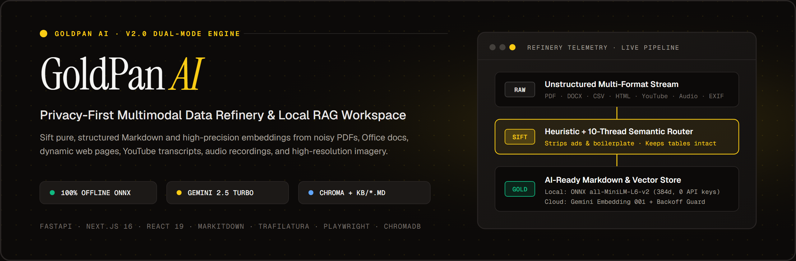
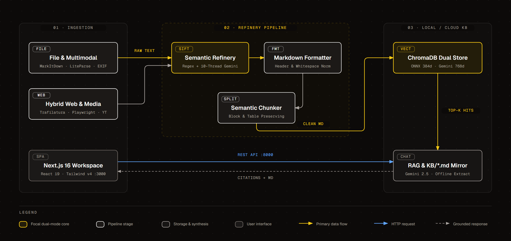
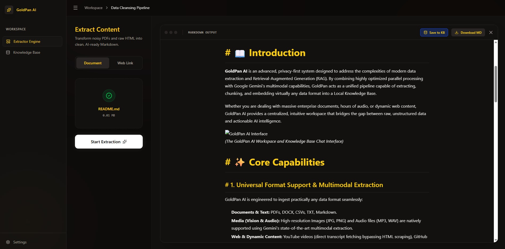
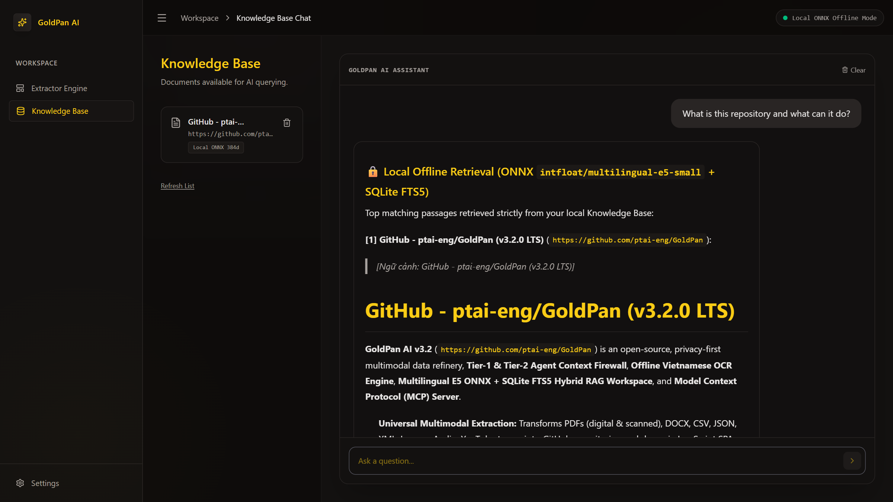

<div align="center">
  
  <br/>
  <br/>

  <p>
    <a href="https://www.python.org/downloads/"></a>
    <a href="https://fastapi.tiangolo.com/"></a>
    <a href="https://nextjs.org/"></a>
    <a href="https://www.trychroma.com/"></a>
    <a href="https://modelcontextprotocol.io/"></a>
    <a href="https://ai.google.dev/"></a>
    <a href="LICENSE"></a>
  </p>

  <p>
    <a href="#-why-goldpan-ai">Why GoldPan</a> •
    <a href="#-system-architecture">Architecture</a> •
    <a href="#-dual-mode-operation">Dual-Mode Engine</a> •
    <a href="#-cli--model-context-protocol-mcp-server">CLI & MCP Server</a> •
    <a href="#-workspace-tour">Workspace Tour</a> •
    <a href="#-quick-start">Quick Start</a> •
    <a href="#-api-reference">API Reference</a>
  </p>
</div>

---

## ⚡ Why GoldPan AI?

Modern RAG pipelines fail before embedding even begins: PDFs arrive with broken tables, web pages carry 60% navigation and ad boilerplate, and naive character-slicing cuts code blocks and tables in half.

**GoldPan AI** is a local-first multimodal data refinery, RAG workspace, CLI, and **Model Context Protocol (MCP) server** built to **sift pure signal ("gold") from noisy unstructured inputs**:

- **Universal Ingestion:** Converts PDFs, Word (`.docx`), Excel/CSV, JSON, XML, Markdown, Images (`.jpg`, `.png`, `.webp`), Audio (`.mp3`, `.wav`, `.m4a`), YouTube videos, GitHub blobs, and JavaScript-heavy web pages into clean, structured Markdown.
- **Two-Stage Noise Refinery:** Strips menus, cookie banners, and marketing boilerplate using deterministic regex rules (`HeuristicFilter`) followed by an optional 10-thread parallel `gemini-2.5-flash` cleanser (`SemanticRouterFilter`).
- **True Dual-Mode Vector Storage:** Runs **100% offline out of the box** using local ONNX embeddings (`all-MiniLM-L6-v2`, 384-dim) in `ChromaDB` with zero API keys required—while seamlessly unlocking cloud-scale `gemini-embedding-001` (with exponential backoff against HTTP 429 limits) and multi-turn generative RAG when a Gemini API key is configured.
- **Native CLI & MCP Server (`goldpan` & `goldpan-mcp`):** Use GoldPan directly from the terminal or plug it into **Claude Desktop, Claude Code, Cursor, Windsurf, or Antigravity** as a `stdio` MCP tool provider with strict context-window budgets (`detail: "summary" | "complete"`), explicit `coverage`, and untrusted-content provenance tags (`_meta.provenance.untrusted_content = true`).
- **Human-Auditable `KB/*.md` Mirror:** Every ingested document is saved both as semantic chunks in ChromaDB and as a clean physical `.md` file inside `KB/` for Git versioning, Obsidian/IDE inspection, or external agent consumption.

---

## 🏗️ System Architecture

<div align="center">
  
</div>

The backend pipeline (`backend/goldpan/`) is organized into four decoupled layers:

1. **Extractors (`goldpan/extractors/` & `goldpan/vision/`):**
   - `MarkItDownExtractor` — Microsoft MarkItDown engine extended with `GeminiMultimodalConverter` (priority `-1.0`) and `HybridVisionCaptioner` (local Pillow EXIF/geometry inspection + cloud OCR/transcription).
   - `LiteParseExtractor` — Zero-overhead parser for structured `.csv` (auto-converted to Markdown tables), `.json`, `.xml`, `.md`, and `.txt`.
   - `HybridWebExtractor` — Direct YouTube transcript retrieval (`youtube-transcript-api`), GitHub blob-to-raw translation, `Trafilatura` main-text extraction, and automatic headless Chromium fallback (`Playwright`) when DOM text is under 500 characters.
2. **Refinery Filters (`goldpan/filters/`):**
   - `HeuristicFilter` — Fast line-level boilerplate stripping (cookie notices, newsletter prompts, standalone nav links) with byte-level telemetry.
   - `SemanticRouterFilter` — Splits large documents into 15,000-character blocks and processes up to 10 chunks concurrently via `ThreadPoolExecutor` at `temperature=0.0` (or falls back to local paragraph-density heuristics when offline).
3. **Formatter (`goldpan/formatters/`):**
   - `AIFriendlyMarkdownFormatter` — Normalizes ATX headings, collapses excessive whitespace, injects missing document titles, and forwards noise-reduction metrics.
4. **Dual-Mode Knowledge Base (`goldpan/kb/chroma_manager.py`):**
   - **Markdown-Aware Semantic Chunker** preserves paragraph boundaries, headings, and tables before slicing.
   - Manages isolated vector spaces (`goldpan_kb_local` at 384d and `goldpan_kb_gemini` at 768d) so offline and cloud embeddings never collide.

---

## 🔀 Dual-Mode Operation

GoldPan AI never locks you out when you work offline or hit free-tier API quotas:

| Capability | 🔒 Local Offline Mode (No API Key) | ⚡ Gemini Cloud Turbo Mode (`X-Gemini-Api-Key`) |
| :--- | :--- | :--- |
| **Documents & Structured Files** | `MarkItDown` + `LiteParse` (100% Local) | `MarkItDown` + `LiteParse` (100% Local) |
| **Dynamic Web & YouTube** | `Trafilatura` + `Playwright` + `YouTubeTranscriptApi` | `Trafilatura` + `Playwright` + `YouTubeTranscriptApi` |
| **Images (`.jpg`, `.png`, `.webp`)** | Local Pillow resolution, color mode & EXIF inspector | Full `gemini-2.5-flash` Vision OCR, table & scene extraction |
| **Audio (`.mp3`, `.wav`, `.m4a`)** | Requires API Key | Native `gemini-2.5-flash` multimodal transcription |
| **Refinery Filter** | `HeuristicFilter` + Local Paragraph Density Router | `HeuristicFilter` + 10-Thread `gemini-2.5-flash` Cleanser |
| **Vector Embeddings (ChromaDB)** | **Local ONNX `all-MiniLM-L6-v2` (384-dim, 0 cost)** | `gemini-embedding-001` with Exponential Backoff + ONNX Fallback |
| **Knowledge Base Querying** | Extractive Semantic Passage Retrieval + Citations | Multi-Turn Grounded RAG Synthesis + Source Citations |

---

## 🧰 CLI & Model Context Protocol (MCP) Server

GoldPan v2.0 ships with an installable Python package (`pyproject.toml`) exposing both a rich terminal CLI (`goldpan`) and a standard `stdio` JSON-RPC 2.0 MCP Server (`goldpan-mcp`).

### 1. Command-Line Interface (`goldpan`)

```powershell
# Install GoldPan in editable mode inside your virtual environment
pip install -e .

# Extract clean Markdown from a URL or local file (defaults to summary budget)
goldpan extract https://example.com --detail summary --max-chars 4000

# Extract full Markdown and save directly to a file + ingest into ChromaDB
goldpan extract ./report.pdf --output ./clean_report.md --ingest

# Ingest any document or URL into the 100% offline Local ONNX Knowledge Base
goldpan ingest ./architecture.docx --local

# Run semantic vector search with distance scores and citations
goldpan search "How does the dual-mode vector storage avoid dimension collisions?" --top-k 4

# List or delete indexed Knowledge Base documents
goldpan kb-list
goldpan kb-delete <document_id>
```

### 2. MCP Server (`goldpan-mcp`) for AI Coding Agents

Register `goldpan-mcp` in **Claude Desktop**, **Claude Code**, **Cursor**, or **Antigravity** (`mcp_config.json` / `claude_desktop_config.json`):

```json
{
  "mcpServers": {
    "goldpan": {
      "command": "C:/path/to/GoldPan/venv/Scripts/goldpan-mcp.exe",
      "args": [],
      "env": {
        "GEMINI_API_KEY": ""
      }
    }
  }
}
```

#### Exposed MCP Tools & `rea-tool-design` Guarantees

Every MCP tool response enforces **response-budget protection** (`detail: "summary" | "complete"`), **explicit coverage reporting** (`coverage.completeness`, `residual_unknowns`), and **untrusted-target provenance markers** (`_meta.provenance.untrusted_content = true`) to defend downstream agents against indirect prompt injection:

| MCP Tool | Arguments | Description |
| :--- | :--- | :--- |
| `goldpan_extract` | `source`, `detail="summary"`, `max_chars=4000`, `ingest_to_kb=false` | Extracts clean Markdown from any URL, YouTube video, GitHub file, or local document with noise-removal telemetry. |
| `goldpan_kb_ingest` | `markdown`, `title`, `source`, `prefer_local=true` | Chunks and indexes Markdown into ChromaDB (`local_onnx` 384d or `gemini` 768d) and writes a physical `KB/*.md` mirror. |
| `goldpan_kb_search` | `query`, `n_results=4`, `detail="summary"` | Performs semantic vector search across ChromaDB and returns ranked passages with source citations and L2 distance scores. |
| `goldpan_kb_list` | *(none)* | Lists all indexed documents, titles, sources, and chunk counts across local and cloud collections. |
| `goldpan_kb_delete` | `document_id` | Deletes a document's vectors from ChromaDB and removes its physical `KB/*.md` file. |

Plus native **MCP Resources** (`resources/list` and `resources/read`) exposing every indexed document at `goldpan://kb/<document_id>`.

---

## 🖥️ Workspace Tour

Built with **Next.js 16**, **React 19**, **Tailwind CSS v4**, and **Framer Motion** in a high-contrast **Dark Stone & Gold (`#0C0A09` / `#FACC15`)** theme (with Light Mode and UI Zoom scaling built in).

### 1. Data Cleansing & Extraction Engine
Upload documents or paste URLs, monitor real-time elapsed progress, inspect the refined Markdown output, and export `.md` or commit directly to the Knowledge Base.



### 2. Knowledge Base & Grounded RAG Assistant
Manage indexed documents (backed by both ChromaDB vectors and physical `KB/*.md` files) and run multi-turn queries grounded strictly in your ingested sources.



---

## 📂 Project Structure

```text
GoldPan/
├── assets/
│   ├── goldpan-hero-banner.png       # Flagship Dark Stone & Gold hero banner
│   ├── goldpan-architecture.png      # High-DPI system architecture schematic
│   └── goldpan-architecture.html     # Self-contained SVG source (diagram-design spec)
├── backend/
│   ├── goldpan/
│   │   ├── core/
│   │   │   ├── exceptions.py         # ExtractionError, FilterError, FormattingError
│   │   │   ├── pipeline.py           # GoldPanPipeline orchestrator (Protocol-based)
│   │   │   └── schemas.py            # Pydantic models: RawContent, FilteredContent, FinalMarkdown
│   │   ├── extractors/
│   │   │   ├── liteparse_wrapper.py  # Fast CSV->Markdown table, JSON, XML & TXT parser
│   │   │   ├── markitdown_wrapper.py # Office/PDF parser + Gemini Multimodal converter
│   │   │   └── web_extractor.py      # YouTube, GitHub raw, Trafilatura & Playwright fallback
│   │   ├── filters/
│   │   │   ├── heuristic_filter.py   # Regex boilerplate & nav-link stripper
│   │   │   └── semantic_router.py    # 10-thread Gemini cleanser + local heuristic fallback
│   │   ├── formatters/
│   │   │   └── markdown_formatter.py # Heading & whitespace normalizer
│   │   ├── kb/
│   │   │   └── chroma_manager.py     # Dual-mode ONNX (384d) + Gemini (768d) vector manager
│   │   ├── vision/
│   │   │   └── hybrid_captioner.py   # Local Pillow EXIF inspector + Gemini Vision captioner
│   │   ├── cli.py                    # Typer + Rich CLI (`goldpan extract|ingest|search|kb-list`)
│   │   └── mcp_server.py             # stdio JSON-RPC 2.0 MCP Server (`goldpan-mcp`)
│   ├── tests/                        # Sample fixtures (CSV, DOCX, PDF, MP3, JPG, XML) & API tests
│   ├── main.py                       # FastAPI server (:8000)
│   └── requirements.txt              # Backend Python dependencies (UTF-8)
├── frontend/
│   ├── src/app/
│   │   ├── globals.css               # Dark Stone & Gold design tokens
│   │   ├── layout.tsx                # Root layout & theme hydration script
│   │   └── page.tsx                  # Extractor Workspace, KB Manager & RAG Chat SPA
│   └── package.json                  # Next.js 16 + React 19 + Tailwind CSS v4
├── KB/                               # Physical Markdown mirror of ingested documents
├── pyproject.toml                    # Python package & CLI/MCP script entrypoints
├── run_tests.py                      # End-to-end verification suite (pytest compatible)
└── requirements.txt                  # Root Python dependencies
```

---

## 🚀 Quick Start

### Prerequisites
- **Python 3.10+**
- **Node.js 18+**
- *(Optional)* A **Google Gemini API Key** — only needed if you want Cloud Multimodal Audio/Vision extraction and generative LLM synthesis; Local Extraction and Local ONNX Vector Search work out of the box without any key.

### 1. Clone & Install Backend + CLI/MCP

```powershell
git clone https://github.com/ptai-eng/GoldPan.git
cd GoldPan

python -m venv venv
.\venv\Scripts\activate
pip install -r requirements.txt
pip install -e .

# Optional: install Chromium for dynamic JavaScript-heavy web scraping fallback
playwright install chromium
```

### 2. Install Frontend

```powershell
cd frontend
npm install
cd ..
```

### 3. Run the Verification Suite

```powershell
.\venv\Scripts\python.exe -m pytest run_tests.py -v
```

### 4. Launch Backend & Frontend

**Terminal 1 — FastAPI Backend (`http://localhost:8000`):**
```powershell
.\venv\Scripts\activate
cd backend
uvicorn main:app --reload --port 8000
```

**Terminal 2 — Next.js Workspace (`http://localhost:3000`):**
```powershell
cd frontend
npm run dev
```

Open **`http://localhost:3000`** in your browser. Use GoldPan immediately in **Local ONNX Offline Mode**, or click **Settings** in the bottom-left sidebar to add your `AIza...` Gemini API key for **Gemini 2.5 Turbo Mode**.

---

## 🔌 API Reference

All endpoints are served by FastAPI at `http://localhost:8000` (interactive Swagger docs at `http://localhost:8000/docs`). Pass the optional header `X-Gemini-Api-Key: AIza...` to enable cloud features.

| Method | Endpoint | Description |
| :--- | :--- | :--- |
| `POST` | `/api/extract/file` | Multipart file upload (`file`). Returns `{ markdown, metadata: { title, file_path, stats } }`. |
| `POST` | `/api/extract/url` | JSON `{ "url": "https://..." }`. Extracts clean Markdown from articles, GitHub blobs, or YouTube URLs. |
| `POST` | `/api/kb/ingest` | JSON `{ "markdown": "...", "metadata": {...}, "prefer_local": false }`. Saves physical `.md` to `KB/` and upserts vectors into ChromaDB. |
| `GET` | `/api/kb/documents` | Lists all indexed documents across local ONNX and Gemini collections. |
| `DELETE` | `/api/kb/documents/{id}` | Removes a document's vectors from ChromaDB and deletes its physical `.md` mirror from `KB/`. |
| `POST` | `/api/kb/chat` | JSON `{ "message": "...", "history": [...] }`. Returns `{ response, context_used, citations, mode }`. |
| `GET` | `/health` | Health check returning `{ "status": "ok", "version": "2.0.0" }`. |

---

## 📜 License

Released under the [MIT License](LICENSE). Crafted by **[Hoang Kim Phat Tai (ptai-eng)](https://github.com/ptai-eng)**.
